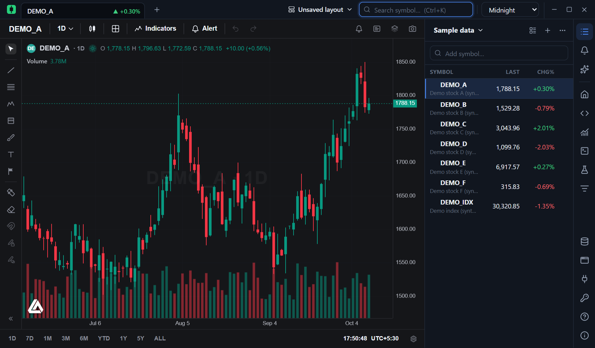
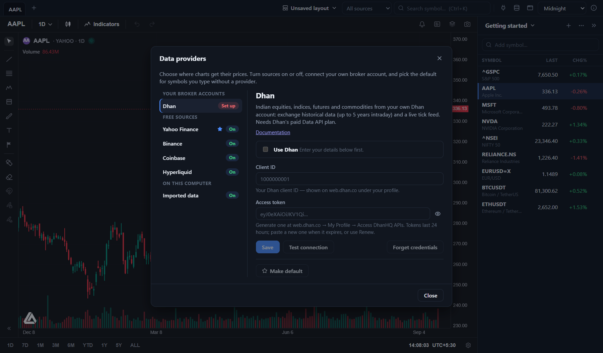
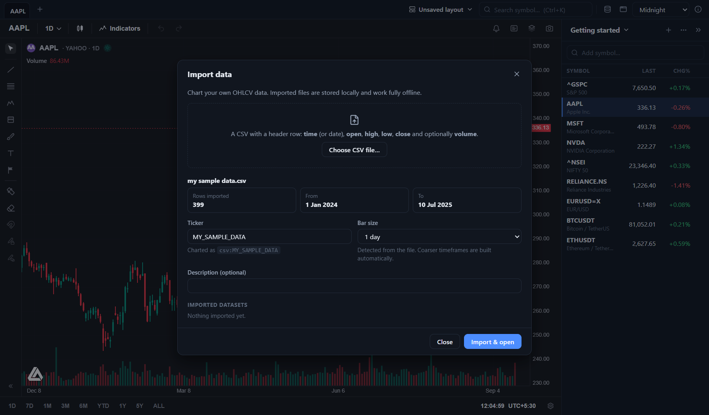

<p align="center">
  <picture>
    <source media="(prefers-color-scheme: dark)" srcset="assets/brand/lockup-on-dark.svg">
    
  </picture>
</p>

# ProTradeChart

**Free, open-source desktop charting.** Fast candlestick charts with indicators and drawing tools, live-updating
watchlists, saved layouts, and the ability to chart your own data — all running locally. Charting your own imported
data needs no account; Indian market data needs your own Zerodha account.

<p align="center">
  
</p>

## Features

- **Serious charts.** Candles, bars, line, area, baseline and Heikin Ashi; a full drawing toolbar (lines, shapes, text
  annotations and more); 70+ built-in indicators; multiple panes; a WebGL2 renderer with a canvas fallback.
  Drawn by [Vela](https://luxalgo.com/vela).
- **Bring your own broker.** Connect a [Zerodha](#connecting-zerodha) account for
  exchange-grade Indian market data — intraday history and a live tick feed. Credentials go in your operating system's
  keychain. More brokers plug into the same system.
- **Price alerts.** Set an alert from a chart (right-click → *Add alert here…*, the **Alert** button, or `Alt+A`) and get a
  notification, a chime and a toast when the price crosses your level — even with the app in the background.
- **You choose the data.** A *Data providers* screen turns each source on or off, holds broker credentials, tests them,
  and sets the default for symbols you type without a provider.
- **Bring your own data.** Import an OHLCV CSV and chart it offline, at any timeframe coarser than the file's own.
- **Chart grids.** Any tab can hold from 1 to 16 charts: pick 1×1 up to 4×4 from the layout button in the chart's toolbar,
  and optionally link the charts' symbol, interval, crosshair and style with the sync switches beside it.
- **Tabs and windows.** Browser-style tabs, each with its own chart grid, and each wearing its symbol's live price and the
  day's change; open extra windows for a multi-monitor setup.
- **Layouts.** Save your whole session — every tab, its chart grid, and each chart's symbol, indicators, drawings and
  settings — as a named layout, and mark one as the default. Layouts don't include the theme; that stays your own choice.
- **Watchlists.** Unlimited lists with live prices and day change, sortable, and importable from a TradingView export. Group
  symbols under sections that fold away, mark them with a colour flag, and drag them into any order; right-click a row for
  its menu. A rail of icons down the right edge switches the side panel between the watchlist and your alerts, and holds the buttons for the Script Editor, the Python tab and the data providers.
- **Pine Script®-compatible scripts.** Write, save and run your own indicators, and backtest strategies against a chart's
  history, in a built-in Script Editor and Strategy Tester (equity curve, performance summary, list of trades). Runs on
  [PineTS](https://github.com/LuxAlgo/PineTS). Backtests are approximate and can differ from TradingView's. Pine Script is a
  trademark of TradingView, Inc.; ProTradeChart is not affiliated with TradingView.
- **Python for screening and research.** A Python tab (`Ctrl+Shift+Y`) beside your charts runs your own scripts against your
  Zerodha data: screen a watchlist, backtest with pandas or any library you install, keep the scripts as plain `.py`
  files. It uses your own Python, and your broker credentials stay in the app. See [Python](#python).
- **Studies: historical market research.** Ask what stocks looked like around past events — *which NSE stocks doubled in
  twelve months, and what were their returns, trend, 52-week range and volume 12, 6, 3 and 1 months before?* Build the Study
  in a form (or start from a template), check the data it needs, run it, and read events, distributions, before/after,
  a control-group comparison and each event on its chart. See [Studies](#studies).
- **Six themes.** Daylight, Paper, Midnight, Graphite, Ocean and Terminal. The starting theme follows your OS's
  light/dark setting.
- **Private by design.** No account and no telemetry. Everything (layouts, watchlists, imported data, a small offline
  price cache) lives in one SQLite file on your machine; the app talks only to the data sources you turn on and, to check
  for updates, GitHub ([details](SECURITY.md#what-the-app-does-and-doesnt-do)).
- **Updates.** ProTradeChart checks GitHub for a newer release about once a day and offers to install it (*About → Updates*).
  Each update is verified against a signing key built into the app before it runs, and the daily check can be switched off.

<p align="center">
  
  
</p>

## Install

Prebuilt installers for Windows, macOS and Linux are produced by the
[release workflow](.github/workflows/release.yml) and attached to each GitHub release. They are **not code-signed**, so Windows SmartScreen and macOS Gatekeeper will warn you the
first time you run one — see [SECURITY.md](SECURITY.md#verifying-a-download). Each release also carries a `SHA256SUMS` file, so you can
[check that a download is intact](SECURITY.md#checking-a-download-against-its-checksum).

Or build it yourself:

### Build from source

You need:

- [Node.js](https://nodejs.org) 20 or newer
- [Rust](https://rustup.rs) (stable)
- The [Tauri prerequisites](https://tauri.app/start/prerequisites/) for your OS (on Windows that's the WebView2
  runtime, which is already present on Windows 11; on Linux, the WebKitGTK development packages)
- On Linux, also `libdbus-1-dev` and `pkg-config` (`sudo apt install libdbus-1-dev pkg-config`) for keychain access

```bash
git clone https://github.com/Swapnilgitlab/ProTradeChart.git
cd ProTradeChart
npm install

npm run tauri:dev      # run with hot reload
npm run tauri:build    # produce an installer in src-tauri/target/release/bundle
```

Other useful scripts:

```bash
npm test               # frontend unit tests (Vitest)
npm run typecheck      # TypeScript
cargo test --manifest-path src-tauri/Cargo.toml --lib    # backend unit tests
```

## Using it

| To… | Do this |
| --- | --- |
| Load a symbol | Type in the search box (`Ctrl+K`) and press Enter. Results come from every data source that is switched on. |
| Set a price alert | Right-click the chart → **Add alert here…** (it starts at the price under the cursor), or the **Alert** button in the chart toolbar, or `Alt+A`. The **Alerts** panel (the bell on the right-hand rail) lists your alerts and shows how many have fired since you last looked. |
| Open another chart | `Ctrl+T`, or the **+** in the tab bar. Middle-click or `Ctrl+W` closes a tab. |
| Show several charts at once | The **Layout** button in the chart's toolbar (next to the timeframe and style buttons): choose a grid from 1×1 to 4×4. New charts start on the same symbol; click one to make it the active chart (it gets a white outline), then search or click a watchlist symbol to change just that chart — the tab label follows it. The sync switches in the same dropdown link symbol, interval, crosshair and style. |
| Write an indicator or backtest a strategy | The **</>** icon on the right-hand rail, or `Ctrl+E`, opens the Script Editor in a tab of its own. Press **+ Indicator** or **+ Strategy** (or pick an example) in the list on the left, write it, then **Add to chart** (`Ctrl+Enter`) — it goes on the chart you last looked at, named in the toolbar; **Save** (`Ctrl+S`) keeps it in your script library. A strategy opens the **Strategy Tester** under its chart (`Ctrl+Shift+E` shows or hides it). The pencil on a script's legend row reopens its code. Scripts on a chart are saved with the layout. |
| Change timeframe / style / indicators | The toolbar at the top of the chart. On the chart itself, press `?` for Vela's own shortcut list. |
| Save your setup | **Layout** menu → *Save as new layout…*. *Set as default* makes it the starting session (and the template for new tabs). |
| Track symbols | The watchlist on the right (`Alt+W` shows or hides it). Click a row to chart it; `↑`/`↓` step through the list. Right-click a row to flag it, add an alert, open it in a new tab or add a section above it; drag rows to reorder, or click a section's name to fold it. |
| Switch the side panel | The icons at the top of the right-hand rail: **Watchlist** and **Alerts**. Press the one that is showing to fold the panel away; the choice is remembered. Below them are the **Script Editor**, **Strategy Tester** and **Python** buttons, and the **Data providers** plug sits at the bottom. |
| Import a watchlist | Watchlist **⋯** menu → *Import from file…* (a TradingView export or a CSV with a `Symbol` column). |
| Chart your own data | The database icon in the tab bar → *Choose CSV file…* |
| Choose and configure data sources | The plug icon at the bottom of the right-hand rail → *Data providers*. |
| Search one source only | The dropdown to the left of the search box (shown when more than one source is on). |
| Use a second monitor | `Ctrl+Shift+N` opens another window. All windows share the same layouts and watchlists. |

### Symbols

Every symbol is `provider:TICKER`. Typing a bare ticker means the default source, Zerodha (NSE), unless you make
another one the default under *Data providers*.

| Prefix | Examples |
| --- | --- |
| `zerodha:` | `zerodha:NSE:RELIANCE`, `zerodha:BSE:TCS`, `zerodha:NSE:NIFTY_50`, `zerodha:NFO:BANKNIFTY26OCTFUT` — `EXCHANGE:SYMBOL`, so a bare `RELIANCE` means NSE |
| `csv:` | `csv:MY_DATA` (your imported files) |

### CSV format

A header row is required. Column names are matched case-insensitively:

```csv
time,open,high,low,close,volume
2024-01-02,187.15,188.44,183.89,185.64,82488700
2024-01-03,184.22,185.88,183.43,184.25,58414500
```

- **Time** may be called `time`, `date`, `datetime` or `timestamp`. Understood formats: `2024-01-02`,
  `2024-01-02 09:15[:30]`, ISO-8601 (with or without a timezone), `YYYYMMDD`, epoch seconds or milliseconds, and
  `DD/MM/YYYY` or `MM/DD/YYYY` (the order is worked out from the data). A time with no timezone is read in your local
  timezone.
- **Volume** is optional. Commas or semicolons or tabs can separate columns; decimal commas and quoted fields are fine.
- Rows are sorted and de-duplicated on import. Rows with a missing price, or a price that isn't above zero, are
  skipped and reported.
- The bar size is detected from the spacing and can be corrected in the dialog. You can then chart the data at that
  timeframe or any coarser one — 1-minute data can be viewed as 5-minute, hourly, daily, weekly or monthly.

## Data sources

| Source | Covers | Timeframes | Live? |
| --- | --- | --- | --- |
| **Zerodha** *(your account)* | Indian equities, indices, futures, commodities | 1, 3, 5, 10, 15, 30, 60 minutes and daily natively; 2h/4h, weekly, monthly and others built from those | Live tick feed |
| **Imported CSV** | Anything you bring | Your file's bar size and coarser | No |

A few things worth knowing:

- **Zerodha is the only broker, and the only live data source.** Binance, Coinbase and Hyperliquid were removed as
  data sources; Indian markets come through Zerodha alone. Symbols saved as `binance:…`, `coinbase:…` or
  `hyperliquid:…` stay in your watchlists, layouts and alerts but can't be loaded, and a layout that holds one opens on a
  starter NSE symbol instead and says so; saving the layout again drops the old symbol.
- **US and world markets** (stocks, ETFs, FX and their indices) have no data source: import your own OHLCV file
  (*Import data*) to chart them.
- A chart opens with about 500 bars (two years of daily candles). **Scroll or zoom back and older candles load
  automatically**, for as long as the source has them. Nothing extra to click.
- Recently loaded broker bars are cached locally so a chart still draws if you go offline.
- **Broker data is yours alone.** Data from a Zerodha account is licensed to you for your own use under your
  broker's and the exchanges' rules: don't rebroadcast it (on a public stream or website, say). The app only reads market
  data from your account; it never places orders.
- This software is for information only and is **not financial advice**.

## Connecting Zerodha

[Zerodha](https://zerodha.com) is India's largest broker; its [Kite Connect](https://kite.trade) API serves exchange data
for NSE, BSE, NFO, MCX and currency markets. Connecting it gives charts Zerodha's history and a live feed.

1. **You need a Kite Connect app with market data.** Zerodha's data APIs (historical candles and quotes) are part of its
   paid Kite Connect subscription; without it the app will say so (*Your Kite Connect plan doesn't include this data*).
   Create the app at [developers.kite.trade](https://developers.kite.trade) and note its **API key** and **API secret**.
2. **Point the Kite app at ProTradeChart.** On your app at [developers.kite.trade](https://developers.kite.trade), set
   the **redirect URL** to `http://127.0.0.1:47821`. That is how the app collects the login for you; it is shown with a
   Copy button beside the login button, and must match exactly.
3. In the app, open **Data providers → Zerodha**, enter the key and secret, and press **Save**.
4. **Log in.** Press *Log in with Zerodha* and sign in on the page that opens. The app catches Zerodha's reply itself and
   fills in the access token — there is nothing to copy. Zerodha switches on, downloads its instrument list, and
   **Test connection** confirms everything works.
5. Search as usual, or type `NSE:RELIANCE` / `NSE:NIFTY_50`. Use **Make default** if you'd rather type a bare `RELIANCE`.

Things worth knowing:

- **Kite tokens expire every morning (around 6 AM).** That is Zerodha's rule, not the app's: each day's first session
  needs a fresh login (step 4) — one button, a few seconds. The dialog shows roughly how long today's token has left, and
  charts say so when it has gone.
- **If your Kite app has to redirect somewhere else** (a website of your own, say), open *Paste the address instead*
  under the login button: sign in, then paste the whole address Zerodha sent your browser to (it contains
  `request_token=…`). A request token works once and only for a few minutes, so paste it straight away.
- **Nothing is opened to the network.** While you log in, the app listens on `127.0.0.1:47821` for that one reply, which
  only programs on this computer can reach; it stops as soon as the token arrives, or after five minutes.
- **Your credentials stay out of the database.** The API secret and access token are kept in your operating system's
  keychain and used only by the app's Rust backend. The secret is used for one thing — signing the login — and is never
  sent anywhere itself.
- **One live connection, shared.** A Kite API key may open three feed connections. The app opens one and shares it between
  every chart, tab and window.
- **Instrument list.** Downloaded per exchange from Zerodha's public files (about 24,000 equities, indices and futures;
  options aren't listed), refreshed weekly. It needs no login.
- **Futures.** Daily charts of NFO and MCX futures ask Kite for continuous data, so they go back past the current
  contract's listing.

> **Status.** Zerodha support was built from Kite Connect's documentation and checked against the live service without
> credentials: its real instrument lists, the real error responses for a bad token and a bad login, and the real
> WebSocket handshake refusal are all covered by tests you can run yourself
> (`cargo test --lib zerodha::live -- --ignored --nocapture`). It hasn't yet been exercised with a Kite Connect account
> that has market data, so treat history and the live feed as new: if a chart's dates look shifted or a live candle
> misbehaves, please [open an issue](../../issues) with the symbol and timeframe.

## Python

Press `Ctrl+Shift+Y` (or the terminal button on the right-hand rail) to open **Python** as a tab beside your charts: a list of
scripts, an editor, a console and the results. Scripts read your Zerodha data through the `protrade` package, and
can use anything you install beside it — pandas, numpy, scipy, vectorbt, `backtesting.py`.

```python
import pandas as pd
import protrade as pt

panel = pt.bars_many(pt.universe(), "D", limit=250, errors="skip")   # {symbol: DataFrame}
above = [{"symbol": s, "close": df["close"].iloc[-1]} for s, df in panel.items()
         if len(df) >= 200 and df["close"].iloc[-1] > df["close"].rolling(200).mean().iloc[-1]]
pt.show(pd.DataFrame(above), title="Above the 200-day average")
```

`pt.show` puts a sortable table in the panel's **Results** tab, where clicking a symbol opens its chart and the whole list
can go to a watchlist. `pt.report(trades=…, equity=…)` shows a backtest — return, drawdown, CAGR, Sharpe, win rate, an
equity curve against a benchmark, and the trades — and `pt.plot()` shows a matplotlib figure.

The first time, press **Set up Python** in the panel. Four example scripts are there to start from: a greeting, three
screens (200-day average, RSI, 52-week highs) and a moving-average crossover backtest. Things worth knowing:

- **It uses your own Python.** The app doesn't ship or download one. It looks for Python 3.10 or newer on your machine, and
  *Set up* makes a private virtual environment in the app's data folder and installs pandas and numpy into it. To use an
  environment of your own instead (conda, uv), give its interpreter in the panel's settings (the gear).
- **Your credentials stay in the app.** The app never hands a script a broker key or token. A script asks the app for bars over a
  local connection (`127.0.0.1`, protected by a one-off token that only scripts the app starts receive); the app fetches, paces
  and keeps them. Only Zerodha and your imported CSV files are available to scripts, and only for reading.
- **Quick the second time.** The app keeps what it fetched, so the first screen over a few hundred symbols takes minutes at the
  brokers' rate limits (Kite allows three history requests a second), and later runs fetch only what is new: outside market
  hours, nothing at all, because a finished day's bar never changes. The settings show how much is kept and can forget it.
- **Timeframes.** Kite serves 1, 3, 5, 10, 15, 30 and 60 minutes and daily. `pt.resample` builds
  the rest, starting each bucket at the session open like the charts do. Daily bars are on a timezone-aware IST index.
- **Your scripts are plain files** in the app's data folder (**Open folder** in the panel): edit them anywhere and keep them in
  git. A script runs only when you press Run, and Stop ends it with everything it started.
- **Results belong to a run.** What a script shows appears in the Results view and is replaced when you run again. Nothing
  a script sends is drawn as HTML: tables are text, and a figure must really be a PNG.
- **The tab keeps working while you look elsewhere.** Switch to a chart and a running script keeps going; come back and its
  console and results are still there. Closing the tab is always allowed; your last *chart* tab isn't, since the watchlist
  and alerts need one. Layouts save charts, not the Python tab.
- **It is not a sandbox.** A script has your own permissions, exactly as if you ran it from a terminal. Run code you trust.
- **It is for research, not trading.** Nothing here places an order.
- **Data plans still apply.** Zerodha's historical data needs the paid Kite Connect plan — the same as
  for charts. Kite tokens still expire every morning; a script then stops with a clear message.

`python/README.md` lists the functions and the connection details.

## Studies

A Study measures what stocks looked like around historical events. Open **Studies** from the flask on the right-hand rail.

1. **Pick a template or start your own.** Templates: 100% and 200% Winners, Breakout Winners, Post-Consolidation Breakouts,
   Volume Expansion, Trend Transition, Relative Strength Leaders, Drawdown Recovery, and a blank Custom Study. Any of them can
   be edited, duplicated and saved under **My Studies**.
2. **Describe it.** The universe (a broker's NSE/BSE instrument list, a watchlist, or symbols you list, with a liquidity
   floor), the period, the **event** (conditions such as *12M return crosses above +100%* or *Close crosses above the prior
   52-week high*, combined with AND), optional **pre-event conditions** (*above the 200 EMA 3 months before*), the observation
   windows before it and the forward windows after it, the **metrics** (returns, SMA/EMA distances and slopes, RSI, ATR, MACD,
   ADX, Bollinger, stochastics, 52-week high/low distances, relative volume, traded value, volatility, drawdowns, relative
   strength against an index) and yes/no **characteristics** to count.
3. **Check the data.** The builder reads the Study back in plain words and lists what it needs: price and volume (from
   Zerodha), index data, and what isn't available. **Market cap, sectors and point-in-time universes are not available
   from these sources**: a market-cap filter can't run, and the builder offers a traded-value floor instead (only if you pick
   it); results warn about survivorship bias.
4. **Run Study.** Python does the work (the same setup as the Python tab), with a progress bar and the time left. The data
   check says beforehand how many stocks will be loaded, how many are already stored and roughly how long the rest take:
   the very first run over a whole exchange fetches every stock's history at your broker's rate limit (Zerodha: about three
   stocks a second, so NSE's ~2,000 shares take ~12 minutes; adding BSE takes several times longer). After that, a quick
   batched quote check brings each stock's latest bar up to date instead of fetching it again, so reruns — including a new
   trading day's first — take seconds. Bonds, gold bonds, T-bills and funds on an exchange's list are left out; tick
   *Trade-for-trade* or *SME* to include those series. *Try it on the first 100 symbols* makes a quick trial.
5. **Read the results.** A summary, the table of every event (click the chart icon to open that stock framed around the
   event, with a mark on it), the typical price path through the event, distributions of each metric at each observation
   point, before vs after, results by liquidity, the events against a **control group** of random non-event dates (or, with
   an outcome set, the events that went on to a gain against those that didn't), and a stock explorer. Runs are stored and
   reopen from **Recent results**.

6. **See what stands out, compare, and keep notes.** Against the comparison group, every measurement is tested (Mann–Whitney,
   with an effect size) and every characteristic (a difference in shares with a 95% interval), adjusted for how many comparisons
   a Study makes; *What stands out* lists the clear differences in words. Pick two results under **Recent results** to compare
   them side by side, and group Studies and results with your notes in a **Research Notebook**.

7. **Ask Claude (optional).** *Ask Claude to draft or change this Study* turns a question in plain words — “what did stocks look
   like 3 months before a 52-week-high breakout on double volume?” — into a Study Specification, or changes the current one
   (“use NSE and BSE, and add ADX”). You see what it proposes, what it changed, what it assumed and what can't be studied with
   the data available, and nothing runs until you press Run Study. **Explain with Claude** on a result writes a plain-language
   reading of it. This uses your own Anthropic API key (click the key icon), kept in your operating system's keychain; your
   question, the spec and a summary of the result (never the events or prices) are sent to Anthropic under your account and
   billed to it.

8. **Research with Claude (optional).** Ask a bigger question — “what do stocks look like before they double, and does it differ
   for those that keep going?” — and Claude proposes up to four Studies that together answer it, each with its purpose and a
   data check. Tick the ones to run and press **Run**: they run one after another (**Stop** skips the rest). Then **Write the
   synthesis** has Claude read across the results, say what they agree on and where the evidence is thin, and suggest follow-up
   questions, each of which becomes a new plan for you to approve. The question, the plan, the Studies, the results and the
   synthesis are all kept in a Research Notebook.

- **Every event, not just today's.** An event is each date the conditions *first* hold, across the whole history, with a
  cooldown so one move is one event. Filters are judged at the time, with no later data.
- **Association, not causation.** The results describe what winners looked like; they don't show that any trait caused a move.
- **The specification is the Study.** It is saved as JSON, carried inside every result with the data span, a data version, and
  the app, engine, Python and pandas versions, so a result can be reproduced. **Generate Python** turns it into a script you
  can read, change and run in the Python tab; **Export** saves the specification, the Python, events / stock / metric CSVs,
  the full result as JSON, or a written report.
- Prices are used exactly as your broker supplies them (adjusted for corporate actions at source).

## Price alerts

An alert watches one symbol and fires when its price **crosses** a level — up, down, or either way — once, or every time
(at most once a minute). To set one:

- **From a chart:** right-click → **Add alert here…** (or right-click the price axis → **Add alert at this price…**); the
  price under your cursor is filled in. Or use the **Alert** button in the chart toolbar, or press `Alt+A`.
- **From the Alerts panel** (the bell on the right-hand rail), which also lists every alert, lets you pause, edit, re-arm or delete them, and shows a
  badge for alerts that fired while you weren't looking.

When one fires you get a system notification (so it reaches you with the app minimised), a toast, and a short chime
(switch it off in the alerts list). Things worth knowing:

- **Alerts work with any data source**, and are checked about every 20 seconds while the app is open. Prices are
  sampled, not streamed, so a spike that comes and goes between two checks can be missed.
- **A crossing is measured from the price when you set the alert.** If the price was already past the level, the alert waits
  for it to come back and cross again; if it crossed while the app was closed, it fires when the app next opens.
- **Alerts are shared by every window.** Only the main window watches prices, so an alert never fires twice.
- Alert levels are not yet drawn on the chart.

## Project layout

```
src/                     React + TypeScript frontend
  chart/                 The Vela wrapper (a grid of one to sixteen charts per tab)
  data/                  Data providers (Zerodha, CSV), symbol search, watchlist quotes
  features/              Workspace (chart, Python and Studies tabs), layouts, watchlist, search, providers, import, about, Pine dock
  features/python/       The Python tab: script list, editor, console, results
  features/studies/      The Studies tab: builder, data readiness, results page, Ask Claude
  studies/               Study Specification, feature grammar, templates, readiness, exports (pure, unit-tested)
  pine/                  Pine Script: engine wiring, layout persistence, backtest report maths (pure, unit-tested)
  lib/                   Pure helpers: timeframes & resampling, CSV and watchlist parsers, IPC wrappers
  theme/                 Theme registry and provider
src-tauri/               Rust backend
  src/store/             SQLite persistence (layouts, watchlists, datasets, Pine scripts, bar cache)
  src/providers.rs       The catalogue of data providers and their settings
  src/secrets.rs         Credentials: OS keychain, with an explicit fallback
  src/zerodha/           Zerodha (Kite Connect): protocol, instrument list, HTTP client, live feed, login
  src/commands.rs        Tauri commands exposed to the frontend
  src/pyapi/             The local data API Python scripts use (read-only, loopback, token-protected)
  src/python/            Finding Python, running and stopping scripts, the scripts folder
  src/ai/                The AI Study Builder's Claude client (the user's own API key; calls made from Rust)
pine/                    Pine indicators bundled with the app (see pine/README.md)
python/                  The `protrade` package (incl. the Study engine), example scripts and their tests (see python/README.md)
docs/                    Architecture notes and screenshots
```

See [docs/ARCHITECTURE.md](docs/ARCHITECTURE.md) for how the pieces fit together, and how to add a data provider or a
theme.

## Contributing

Contributions are very welcome — bug reports, data-source fixes, new providers, themes, translations. Please read
[CONTRIBUTING.md](CONTRIBUTING.md) first; it's short.

## Acknowledgements and licence

ProTradeChart is Copyright (C) 2026 Swapnil Pawar and the ProTradeChart contributors. It is free software, released under
the [GNU Affero General Public License v3.0](LICENSE) (AGPL-3.0-only), and comes with **no warranty**. The complete source
of every release is in this repository, at the release's tag, and each release also carries the source of the AGPL
components it is built on (PineTS, Vela PineTS and Vela, at the exact versions used). If you distribute the app or a
modified version of it, you must do so under the same licence and make your source available.

Pine Script support is built on [**PineTS**](https://github.com/LuxAlgo/PineTS) and
[**Vela PineTS**](https://www.npmjs.com/package/@luxalgo/vela-pinets) by LuxAlgo, both licensed under AGPL-3.0 — which is why
this app is too. "Pine Script" and "TradingView" are registered trademarks of TradingView, Inc.; this project is not
affiliated with, sponsored by, or endorsed by TradingView. The script editor is [CodeMirror](https://codemirror.net) (MIT).

Charts are rendered by [**Vela™**](https://luxalgo.com/vela) by LuxAlgo, licensed under Apache-2.0 with an attribution
requirement — the small logomark at the bottom-left of every chart must stay visible. See
[THIRD_PARTY_NOTICES.md](THIRD_PARTY_NOTICES.md) for that and the other components this project is built on, and
[THIRD_PARTY_LICENSES.txt](THIRD_PARTY_LICENSES.txt) (also in the app, under *About → Third-party licences*) for the licence
text of every one of them.
