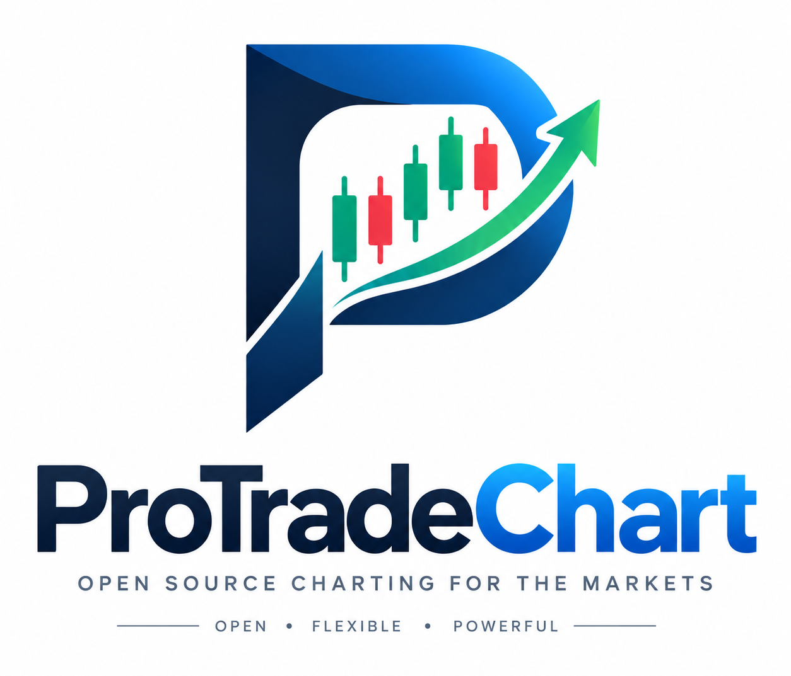

<p align="center">
  
</p>

# ProTradeChart

**Free, open-source desktop charting.** Fast candlestick charts with indicators and drawing tools, live-updating
watchlists, saved layouts, and the ability to chart your own data — all running locally, with no account and no
subscription.

<p align="center">
  
</p>

## Features

- **Serious charts.** Candles, bars, line, area, baseline and Heikin Ashi; a full drawing toolbar (lines, shapes, text
  annotations and more); 70+ built-in indicators; multiple panes; a WebGL2 renderer with a canvas fallback.
  Drawn by [Vela](https://luxalgo.com/vela).
- **Crypto out of the box, stocks through your own broker.** Live-streaming crypto from Binance, Coinbase and Hyperliquid
  works right away, with no account. For Indian equities, indices, futures and commodities, connect your own Dhan or
  Zerodha account, or chart your own files (see [Data sources](#data-sources)).
- **Bring your own broker.** Connect a [Dhan](#connecting-dhan) or [Zerodha](#connecting-zerodha) account for
  exchange-grade Indian market data — intraday history and a live tick feed. Credentials go in your operating system's
  keychain. More brokers plug into the same system.
- **Price alerts.** Set an alert from a chart (right-click → *Add alert here…*, the **Alert** button, or `Alt+A`) and get a
  notification, a chime and a toast when the price crosses your level — even with the app in the background.
- **You choose the data.** A *Data providers* screen turns each source on or off, holds broker credentials, tests them,
  and sets the default for symbols you type without a provider.
- **Bring your own data.** Import an OHLCV CSV and chart it offline, at any timeframe coarser than the file's own.
- **Chart grids.** Any tab can hold from 1 to 16 charts: pick 1×1 up to 4×4 from the layout button in the chart's toolbar,
  and optionally link the charts' symbol, interval, crosshair and style with the sync switches beside it.
- **Tabs and windows.** Browser-style tabs, each with its own chart grid; open extra windows for a multi-monitor setup.
- **Layouts.** Save your whole session — every tab, its chart grid, and each chart's symbol, indicators, drawings and
  settings — as a named layout, and mark one as the default. Layouts don't include the theme; that stays your own choice.
- **Watchlists.** Unlimited lists with live prices and day change, sortable, and importable from a TradingView export.
- **Pine Script®-compatible scripts.** Write, save and run your own indicators, and backtest strategies against a chart's
  history, in a built-in Script Editor and Strategy Tester (equity curve, performance summary, list of trades). Runs on
  [PineTS](https://github.com/LuxAlgo/PineTS). Backtests are approximate and can differ from TradingView's. Pine Script is a
  trademark of TradingView, Inc.; ProTradeChart is not affiliated with TradingView.
- **Six themes.** Daylight, Paper, Midnight, Graphite, Ocean and Terminal. The starting theme follows your OS's
  light/dark setting.
- **Private by design.** No account and no telemetry. Everything (layouts, watchlists, imported data, a small offline
  price cache) lives in one SQLite file on your machine; the app talks only to the data sources you turn on and, to check
  for updates, GitHub ([details](SECURITY.md#what-the-app-does-and-doesnt-do)).
- **Updates.** ProTradeChart checks GitHub for a newer release about once a day and offers to install it (*About → Updates*).
  Each update is verified against a signing key built into the app before it runs, and the daily check can be switched off.

<p align="center">
  
  
</p>

## Install

Prebuilt installers for Windows, macOS and Linux are produced by the
[release workflow](.github/workflows/release.yml) and attached to each GitHub release. They are **not code-signed**, so Windows SmartScreen and macOS Gatekeeper will warn you the
first time you run one — see [SECURITY.md](SECURITY.md#verifying-a-download). Each release also carries a `SHA256SUMS` file, so you can
[check that a download is intact](SECURITY.md#checking-a-download-against-its-checksum).

Or build it yourself:

### Build from source

You need:

- [Node.js](https://nodejs.org) 20 or newer
- [Rust](https://rustup.rs) (stable)
- The [Tauri prerequisites](https://tauri.app/start/prerequisites/) for your OS (on Windows that's the WebView2
  runtime, which is already present on Windows 11; on Linux, the WebKitGTK development packages)
- On Linux, also `libdbus-1-dev` and `pkg-config` (`sudo apt install libdbus-1-dev pkg-config`) for keychain access

```bash
git clone https://github.com/Swapnilgitlab/ProTradeChart.git
cd ProTradeChart
npm install

npm run tauri:dev      # run with hot reload
npm run tauri:build    # produce an installer in src-tauri/target/release/bundle
```

Other useful scripts:

```bash
npm test               # frontend unit tests (Vitest)
npm run typecheck      # TypeScript
cargo test --manifest-path src-tauri/Cargo.toml --lib    # backend unit tests
```

## Using it

| To… | Do this |
| --- | --- |
| Load a symbol | Type in the search box (`Ctrl+K`) and press Enter. Results come from every data source that is switched on. |
| Set a price alert | Right-click the chart → **Add alert here…** (it starts at the price under the cursor), or the **Alert** button in the chart toolbar, or `Alt+A`. The bell in the tab bar lists your alerts and shows how many have fired since you last looked. |
| Open another chart | `Ctrl+T`, or the **+** in the tab bar. Middle-click or `Ctrl+W` closes a tab. |
| Show several charts at once | The **Layout** button in the chart's toolbar (next to the timeframe and style buttons): choose a grid from 1×1 to 4×4. New charts start on the same symbol; click one to make it the active chart (it gets a white outline), then search or click a watchlist symbol to change just that chart — the tab label follows it. The sync switches in the same dropdown link symbol, interval, crosshair and style. |
| Write an indicator or backtest a strategy | The **</>** icon in the tab bar, or `Ctrl+E`, opens the Script Editor. Pick an example from **Open**, edit it, then **Add to chart** (`Ctrl+Enter`); **Save** (`Ctrl+S`) keeps it in your script library. A strategy opens the **Strategy Tester**. The pencil on a script's legend row reopens its code. Scripts on a chart are saved with the layout. |
| Change timeframe / style / indicators | The toolbar at the top of the chart. On the chart itself, press `?` for Vela's own shortcut list. |
| Save your setup | **Layout** menu → *Save as new layout…*. *Set as default* makes it the starting session (and the template for new tabs). |
| Track symbols | The watchlist on the right. Click a row to chart it; `↑`/`↓` step through the list. |
| Import a watchlist | Watchlist **⋯** menu → *Import from file…* (a TradingView export or a CSV with a `Symbol` column). |
| Chart your own data | The database icon in the tab bar → *Choose CSV file…* |
| Choose and configure data sources | The plug icon in the tab bar → *Data providers*. |
| Search one source only | The dropdown to the left of the search box (shown when more than one source is on). |
| Use a second monitor | `Ctrl+Shift+N` opens another window. All windows share the same layouts and watchlists. |

### Symbols

Every symbol is `provider:TICKER`. Typing a bare ticker means the default source, Binance, unless you make another one
the default under *Data providers*.

| Prefix | Examples |
| --- | --- |
| `binance:` | `binance:BTCUSDT`, `binance:ETHUSDT.P` (perpetual futures) |
| `coinbase:` | `coinbase:BTC-USD` |
| `hyperliquid:` | `hyperliquid:BTC` |
| `dhan:` | `dhan:NSE:RELIANCE`, `dhan:BSE:TCS`, `dhan:IDX:NIFTY`, `dhan:NFO:BANKNIFTY-OCT2026-FUT`, `dhan:MCX:GOLD-05OCT2026-FUT` — `EXCHANGE:SYMBOL`, so a bare `RELIANCE` means NSE |
| `csv:` | `csv:MY_DATA` (your imported files) |

### CSV format

A header row is required. Column names are matched case-insensitively:

```csv
time,open,high,low,close,volume
2024-01-02,187.15,188.44,183.89,185.64,82488700
2024-01-03,184.22,185.88,183.43,184.25,58414500
```

- **Time** may be called `time`, `date`, `datetime` or `timestamp`. Understood formats: `2024-01-02`,
  `2024-01-02 09:15[:30]`, ISO-8601 (with or without a timezone), `YYYYMMDD`, epoch seconds or milliseconds, and
  `DD/MM/YYYY` or `MM/DD/YYYY` (the order is worked out from the data). A time with no timezone is read in your local
  timezone.
- **Volume** is optional. Commas or semicolons or tabs can separate columns; decimal commas and quoted fields are fine.
- Rows are sorted and de-duplicated on import. Rows with a missing price, or a price that isn't above zero, are
  skipped and reported.
- The bar size is detected from the spacing and can be corrected in the dialog. You can then chart the data at that
  timeframe or any coarser one — 1-minute data can be viewed as 5-minute, hourly, daily, weekly or monthly.

## Data sources

| Source | Covers | Timeframes | Live? |
| --- | --- | --- | --- |
| **Binance** | Spot and perpetual crypto | 1 minute to monthly | Live stream |
| **Coinbase** | Spot crypto | 1 minute to monthly | Live stream |
| **Hyperliquid** | Perpetual and spot crypto | 1 minute to monthly | Live stream |
| **Dhan** *(your account)* | Indian equities, indices, futures, commodities | 1, 5, 15, 25, 60 minutes and daily natively; 2h/4h, weekly, monthly and others built from those | Live tick feed |
| **Zerodha** *(your account)* | Indian equities, indices, futures, commodities | 1, 3, 5, 10, 15, 30, 60 minutes and daily natively; 2h/4h, weekly, monthly and others built from those | Live tick feed |
| **Imported CSV** | Anything you bring | Your file's bar size and coarser | No |

A few things worth knowing:

- **Yahoo Finance is no longer a data source.** It was removed, and with it the app's only source for US and most world
  stocks, ETFs, FX and indices. To chart those, import your own OHLCV file (*Import data*). Symbols saved earlier as
  `yahoo:…` stay in your watchlists and layouts but can't be loaded; opening a layout that holds one moves that tab to
  Bitcoin and says so, and saving the layout again drops the old symbol.
- A chart opens with about 500 bars (two years of daily candles). **Scroll or zoom back and older candles load
  automatically**, for as long as the source has them. Nothing extra to click.
- Recently loaded broker bars are cached locally so a chart still draws if you go offline.
- **Crypto** comes from the exchanges' public market-data APIs, under their own terms
  ([Binance](https://www.binance.com/en/terms), [Coinbase](https://www.coinbase.com/legal/market_data),
  [Hyperliquid](https://app.hyperliquid.xyz/terms)). The app only reads prices — it never trades. Where binance.com is
  blocked it uses Binance.US; some sources simply aren't available in some countries, and the app doesn't work around that.
- **Broker data is yours alone.** Data from a Dhan or Zerodha account is licensed to you for your own use under your
  broker's and the exchanges' rules: don't rebroadcast it (on a public stream or website, say). The app only reads market
  data from your account; it never places orders.
- This software is for information only and is **not financial advice**.

## Connecting Dhan

[Dhan](https://dhan.co) is an Indian broker with an API for exchange data. Connecting it gives charts up to five years of
intraday history and a live feed for NSE and BSE equities, indices, futures and MCX commodities.

1. **You need Dhan's Data API access.** Dhan's *trading* APIs are free, but market data is a separate paid plan; without it
   the app will say so (`Data APIs not subscribed`).
2. On [web.dhan.co](https://web.dhan.co) open your profile → **Access DhanHQ APIs** and generate an **access token**. Note
   your **client ID** too.
3. In the app, open **Data providers → Dhan**, enter both, and press **Save**. Dhan switches on, downloads its instrument
   list (about 26 MB, refreshed weekly), and **Test connection** confirms everything works.
4. Search as usual (Dhan's results are listed first), or type `NSE:RELIANCE`. Use **Make default** if you'd rather type a bare
   `RELIANCE`.

Things worth knowing:

- **Tokens last 24 hours.** The dialog shows how long yours has left. **Renew** extends a web-generated token by another
  24 hours; otherwise paste a fresh one. When a token expires, charts say so and how to fix it.
- **Your credentials stay out of the database.** The access token is kept in your operating system's keychain (Windows
  Credential Manager, macOS Keychain, or the Linux Secret Service) and is only ever used by the app's Rust backend — the
  web view never sees it. Where no keychain exists, it falls back to the app's database and *tells you that it is unencrypted*.
- **One live connection, shared.** Dhan allows five feed connections per user. The app opens one and shares it between every
  chart, tab and window, and connects only while a chart needs it.
- **Options aren't listed** (there are ~150,000; they'd bury every search). Futures are.

> **Status.** Dhan support was built from Dhan's public documentation and checked against the live service's real error
> responses, its instrument list, and a local simulator of its feed. It hasn't yet been exercised with a funded Data API
> account, so treat it as new: if a chart's dates look shifted or a live candle misbehaves, please
> [open an issue](../../issues) with the symbol and timeframe.

## Connecting Zerodha

[Zerodha](https://zerodha.com) is India's largest broker; its [Kite Connect](https://kite.trade) API serves exchange data
for NSE, BSE, NFO, MCX and currency markets. Connecting it gives charts Zerodha's history and a live feed.

1. **You need a Kite Connect app with market data.** Zerodha's data APIs (historical candles and quotes) are part of its
   paid Kite Connect subscription; without it the app will say so (*Your Kite Connect plan doesn't include this data*).
   Create the app at [developers.kite.trade](https://developers.kite.trade) and note its **API key** and **API secret**.
2. **Point the Kite app at ProTradeChart.** On your app at [developers.kite.trade](https://developers.kite.trade), set
   the **redirect URL** to `http://127.0.0.1:47821`. That is how the app collects the login for you; it is shown with a
   Copy button beside the login button, and must match exactly.
3. In the app, open **Data providers → Zerodha**, enter the key and secret, and press **Save**.
4. **Log in.** Press *Log in with Zerodha* and sign in on the page that opens. The app catches Zerodha's reply itself and
   fills in the access token — there is nothing to copy. Zerodha switches on, downloads its instrument list, and
   **Test connection** confirms everything works.
5. Search as usual, or type `NSE:RELIANCE` / `NSE:NIFTY_50`. Use **Make default** if you'd rather type a bare `RELIANCE`.

Things worth knowing:

- **Kite tokens expire every morning (around 6 AM).** That is Zerodha's rule, not the app's: each day's first session
  needs a fresh login (step 4) — one button, a few seconds. The dialog shows roughly how long today's token has left, and
  charts say so when it has gone.
- **If your Kite app has to redirect somewhere else** (a website of your own, say), open *Paste the address instead*
  under the login button: sign in, then paste the whole address Zerodha sent your browser to (it contains
  `request_token=…`). A request token works once and only for a few minutes, so paste it straight away.
- **Nothing is opened to the network.** While you log in, the app listens on `127.0.0.1:47821` for that one reply, which
  only programs on this computer can reach; it stops as soon as the token arrives, or after five minutes.
- **Your credentials stay out of the database.** The API secret and access token are kept in your operating system's
  keychain and used only by the app's Rust backend. The secret is used for one thing — signing the login — and is never
  sent anywhere itself.
- **One live connection, shared.** A Kite API key may open three feed connections. The app opens one and shares it between
  every chart, tab and window.
- **Instrument list.** Downloaded per exchange from Zerodha's public files (about 24,000 equities, indices and futures;
  options aren't listed), refreshed weekly. It needs no login.
- **Futures.** Daily charts of NFO and MCX futures ask Kite for continuous data, so they go back past the current
  contract's listing.

> **Status.** Zerodha support was built from Kite Connect's documentation and checked against the live service without
> credentials: its real instrument lists, the real error responses for a bad token and a bad login, and the real
> WebSocket handshake refusal are all covered by tests you can run yourself
> (`cargo test --lib zerodha::live -- --ignored --nocapture`). It hasn't yet been exercised with a Kite Connect account
> that has market data, so treat history and the live feed as new: if a chart's dates look shifted or a live candle
> misbehaves, please [open an issue](../../issues) with the symbol and timeframe.

## Price alerts

An alert watches one symbol and fires when its price **crosses** a level — up, down, or either way — once, or every time
(at most once a minute). To set one:

- **From a chart:** right-click → **Add alert here…** (or right-click the price axis → **Add alert at this price…**); the
  price under your cursor is filled in. Or use the **Alert** button in the chart toolbar, or press `Alt+A`.
- **From the bell** in the tab bar, which also lists every alert, lets you pause, edit, re-arm or delete them, and shows a
  badge for alerts that fired while you weren't looking.

When one fires you get a system notification (so it reaches you with the app minimised), a toast, and a short chime
(switch it off in the alerts list). Things worth knowing:

- **Alerts work with any data source**, including your broker accounts and crypto, and are checked about every 20 seconds
  while the app is open. Prices are sampled, not streamed, so a spike that comes and goes between two checks can be missed.
- **A crossing is measured from the price when you set the alert.** If the price was already past the level, the alert waits
  for it to come back and cross again; if it crossed while the app was closed, it fires when the app next opens.
- **Alerts are shared by every window.** Only the main window watches prices, so an alert never fires twice.
- Alert levels are not yet drawn on the chart.

## Project layout

```
src/                     React + TypeScript frontend
  chart/                 The Vela wrapper (a grid of one to sixteen charts per tab)
  data/                  Data providers (crypto, brokers, CSV), symbol search, watchlist quotes
  features/              Workspace (tabs), layouts, watchlist, search, providers, dataset import, about, Pine dock
  pine/                  Pine Script: engine wiring, layout persistence, backtest report maths (pure, unit-tested)
  lib/                   Pure helpers: timeframes & resampling, CSV and watchlist parsers, IPC wrappers
  theme/                 Theme registry and provider
src-tauri/               Rust backend
  src/store/             SQLite persistence (layouts, watchlists, datasets, Pine scripts, bar cache)
  src/providers.rs       The catalogue of data providers and their settings
  src/secrets.rs         Credentials: OS keychain, with an explicit fallback
  src/dhan/              Dhan: protocol, instrument list, HTTP client, live feed
  src/commands.rs        Tauri commands exposed to the frontend
pine/                    Pine indicators bundled with the app (see pine/README.md)
docs/                    Architecture notes and screenshots
```

See [docs/ARCHITECTURE.md](docs/ARCHITECTURE.md) for how the pieces fit together, and how to add a data provider or a
theme.

## Contributing

Contributions are very welcome — bug reports, data-source fixes, new providers, themes, translations. Please read
[CONTRIBUTING.md](CONTRIBUTING.md) first; it's short.

## Acknowledgements and licence

ProTradeChart is Copyright (C) 2026 Swapnil Pawar and the ProTradeChart contributors. It is free software, released under
the [GNU Affero General Public License v3.0](LICENSE) (AGPL-3.0-only), and comes with **no warranty**. The complete source
of every release is in this repository, at the release's tag, and each release also carries the source of the AGPL
components it is built on (PineTS, Vela PineTS and Vela, at the exact versions used). If you distribute the app or a
modified version of it, you must do so under the same licence and make your source available.

Pine Script support is built on [**PineTS**](https://github.com/LuxAlgo/PineTS) and
[**Vela PineTS**](https://www.npmjs.com/package/@luxalgo/vela-pinets) by LuxAlgo, both licensed under AGPL-3.0 — which is why
this app is too. "Pine Script" and "TradingView" are registered trademarks of TradingView, Inc.; this project is not
affiliated with, sponsored by, or endorsed by TradingView. The script editor is [CodeMirror](https://codemirror.net) (MIT).

Charts are rendered by [**Vela™**](https://luxalgo.com/vela) by LuxAlgo, licensed under Apache-2.0 with an attribution
requirement — the small logomark at the bottom-left of every chart must stay visible. See
[THIRD_PARTY_NOTICES.md](THIRD_PARTY_NOTICES.md) for that and the other components this project is built on, and
[THIRD_PARTY_LICENSES.txt](THIRD_PARTY_LICENSES.txt) (also in the app, under *About → Third-party licences*) for the licence
text of every one of them.
